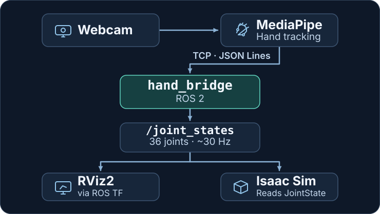

# Hand Motion RViz

웹캠으로 손가락 굽힘과 손목 회전을 추적해 RViz2와 Isaac Sim의 양손 36관절 모델에 표시합니다.



## 빠른 실행

```bash
git clone https://github.com/utf-404/hand-motion-rviz-public.git
cd hand-motion-rviz-public
```

### 웹캠과 RViz2

Ubuntu 22.04에서 ROS 2 Humble과 카메라 의존성을 준비한 뒤 실행합니다. [설치 안내](docs/setup-and-run.md#설치)

```bash
./scripts/start_all.sh
```

### Isaac Sim 데모

Isaac Sim 6.2와 `xacro`가 있으면 카메라 없이 양손 움직임을 볼 수 있습니다. [Isaac Sim 준비](docs/setup-and-run.md#isaac-sim-실행)

```bash
./scripts/start_isaacsim.sh --demo
```

웹캠 움직임을 두 화면에서 함께 보려면 `start_all.sh`를 켜 둔 상태에서 다른 터미널에 `./scripts/start_isaacsim.sh`를 실행합니다.

## 상세 문서

- 카메라 설정, 수동 실행, SSH, 화면 없는 데모 [설치와 실행](docs/setup-and-run.md)
- 관절 구성, TCP 메시지, 모델 이미지, 테스트 [모델과 통신](docs/model-and-protocol.md)
- 손목 좌표계와 화면 배치 [손목 방향](docs/hand-orientation.md)
- 카메라, ROS 토픽, Isaac Sim 화면 확인 [문제 해결](docs/troubleshooting.md)

## 버전과 라이선스

`main`은 RViz2와 Isaac Sim을 지원합니다. RViz2 버전은 [Ver1.0](https://github.com/utf-404/hand-motion-rviz-public/tree/Ver1.0), Isaac Sim 연동 버전은 [Ver2.0](https://github.com/utf-404/hand-motion-rviz-public/tree/Ver2.0)에서 볼 수 있습니다.

코드, 문서, 자체 생성 모델 자산에는 [Apache License 2.0](LICENSE)이 적용됩니다. Copyright 2026 utf-404.

문의와 오류 보고는 [GitHub Issues](https://github.com/utf-404/hand-motion-rviz-public/issues)에 남겨 주세요.
