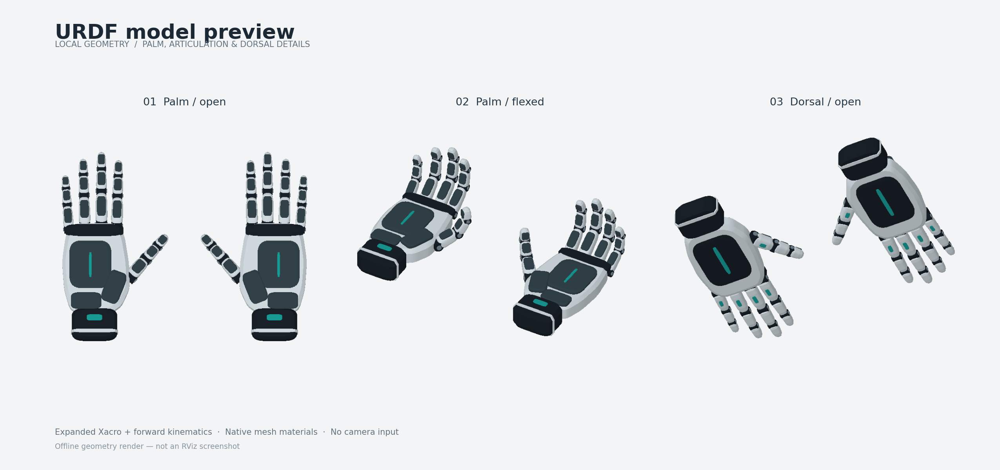

# 손 모델과 통신

웹캠 트래커는 MediaPipe로 양손 자세를 추정하고 손가락 굽힘과 손목 방향을 TCP로 보냅니다. 로컬 기본 연결은 `127.0.0.1:18765`입니다. ROS 2의 `hand_bridge`는 입력을 관절 각도로 바꾸고 `/joint_states`에 약 30Hz로 발행합니다.

- RViz2는 `robot_state_publisher`가 계산한 TF로 양손을 표시합니다. 기본 Fixed Frame은 `hands_base`입니다.
- Isaac Sim은 같은 Xacro와 STL로 손 모델을 만들고, `/joint_states`를 구독해 각도를 관절 이름에 맞춰 적용합니다.
- 관절 이름에는 `left_` 또는 `right_`가 붙습니다. 양손의 장착 위치는 고정되어 있고 손가락 굽힘과 손목 회전이 움직입니다.

## 관절 구성

손가락마다 추정한 굽힘값 하나를 세 관절에 나눠 적용합니다. 각 관절 각도는 굽힘값에 아래 최대각을 곱한 값입니다.

| 손가락 | 관절 | 최대 굽힘각 |
| --- | --- | --- |
| 엄지 | CMC, MCP, IP | 0.75, 1.05, 1.10 rad |
| 검지, 중지, 약지, 소지 | MCP, PIP, DIP | 1.15, 1.35, 0.95 rad |

손가락 30관절 다음에 왼손과 오른손의 손목 yaw(Z), pitch(Y), roll(X)가 발행됩니다. 손목의 방향 추정과 좌표 변환은 [손목 방향](hand-orientation.md)에 정리했습니다.

## TCP 메시지

UTF-8 JSON 한 줄에 줄바꿈을 붙여 전송합니다. 한 프레임 한도는 16 KiB입니다.

```json
{"hands":{"left":[0,0.2,0.4,0.6,1],"right":[0,0,0,0,0]},"wrist_rpy":{"left":[0.2,-0.1,0.4],"right":[0,0,0]},"frame_id":42,"captured_at":1793920000.0}
```

- `hands.left`와 `hands.right`는 각각 엄지부터 소지까지 유한한 숫자 다섯 개입니다. 브리지는 입력을 0~1 범위로 제한합니다.
- 선택 항목인 `wrist_rpy`는 각 손의 `[roll, pitch, yaw]`를 라디안 단위로 담습니다. 생략하면 두 손 모두 기본 방향을 씁니다. 값이 포함된 경우 두 손의 세 각도가 모두 유효해야 합니다.
- 자세에 문자열, 불리언, NaN, Infinity가 들어오면 프레임 전체를 버립니다.
- `frame_id`는 실행 중 증가하는 번호이고, `captured_at`은 Unix 초 단위의 촬영 시각입니다. 두 항목은 선택 사항입니다. 끊김은 마지막 유효 프레임의 로컬 수신 시각으로 판단하고 `/joint_states`의 타임스탬프에는 ROS 발행 시각을 넣습니다.

## 모델 미리보기

아래 이미지의 손바닥, 굽힌 자세, 손등은 같은 URDF를 렌더링한 결과입니다.



STL과 미리보기를 다시 만들려면 저장소 루트에서 실행합니다. 미리보기는 `xacro`, NumPy, Matplotlib을 사용합니다. [가상환경 준비](setup-and-run.md#설치)

```bash
python3 scripts/generate_hand_meshes.py
.venv/bin/python -m pip install matplotlib
PATH="$PWD/.venv/bin:$PATH" .venv/bin/python scripts/render_hand_preview.py
```

## 개발 검증

저장소 루트에서 기본 검사와 실행기 Bash 구문을 확인합니다. 모델 검사를 함께 실행하려면 `xacro`가 필요합니다.

```bash
python3 -m unittest discover -s tests -v
for script in scripts/start_*.sh; do bash -n "$script"; done
```

ROS 통합 검사는 합성 TCP 입력, 36관절 발행, 연결 종료 뒤 열린 자세 복귀, 양손 palm TF를 확인합니다. [ROS 설치 안내](setup-and-run.md#설치)

```bash
source /opt/ros/humble/setup.bash
colcon build --symlink-install --packages-select hand_motion_rviz
HAND_RVIZ_ROS_TESTS=1 python3 -m unittest discover -s tests -v
```

웹캠 추적 품질과 두 뷰어의 동시 표시는 데스크톱에서 확인합니다. [장치와 토픽 문제 해결](troubleshooting.md)

## 소스 위치

- MediaPipe 추적과 TCP 전송 [tracker](../src/hand_motion_rviz/tracker/)
- ROS 2 관절 발행과 입력 검증 [hand_motion_rviz](../src/hand_motion_rviz/hand_motion_rviz/)
- 양손 Xacro와 메시 [urdf](../src/hand_motion_rviz/urdf/) · [meshes](../src/hand_motion_rviz/meshes/)
- Isaac Sim 모델 변환과 관절 구독 [isaac_hand](../isaac_hand/)
